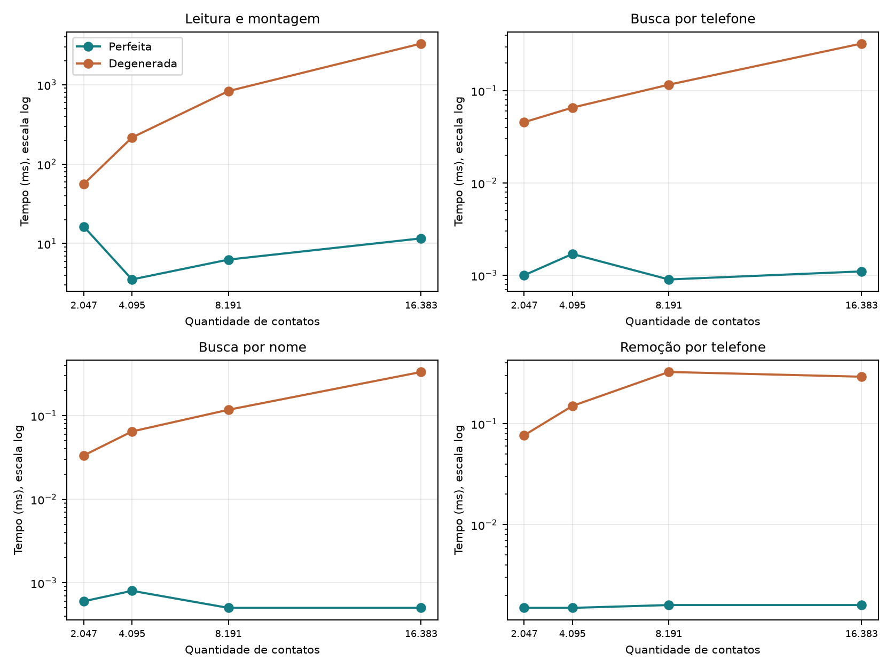
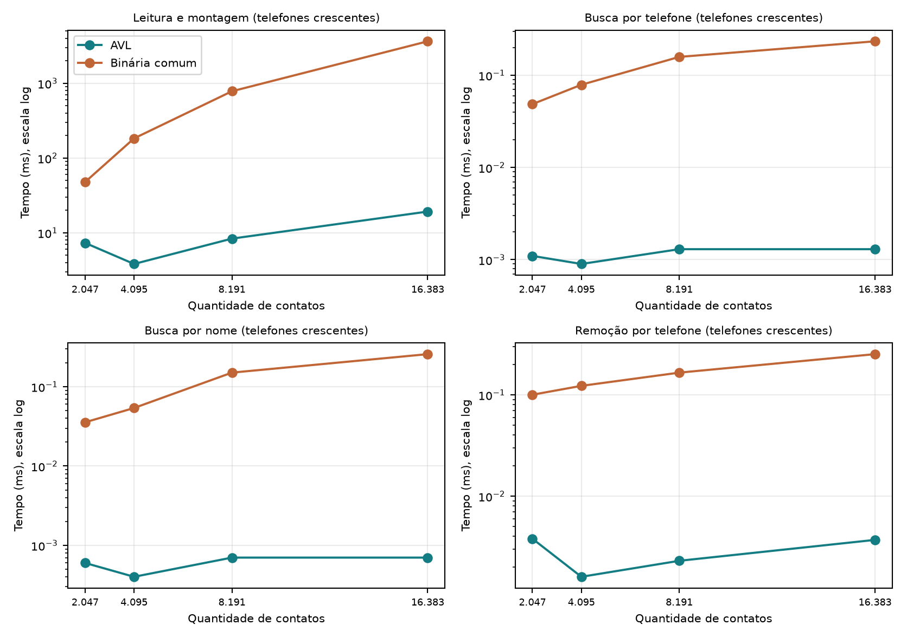

INSTITUTO FEDERAL DO ESPÍRITO SANTO
Campus Serra

Trabalho 2
Árvores binárias

Relatório final - seções 1 a 6

Técnicas de Programação Avançada
Professor: Victorio Albani de Carvalho

| Integrantes |

| --- |

| Bernardo Simão Rosa |

| Matheus Abreu |

| Levi Monteiro |


## Conteúdo desta entrega


1. Desenvolvimento
2. Análise matemática de complexidade
3. Análise empírica de complexidade
4. Árvore AVL: análise matemática
5. Árvore AVL: análise empírica
6. Árvores binárias na biblioteca padrão de Java

Serra - ES | Outubro de 2026


# 1. Desenvolvimento


## 1.1 Biblioteca e aplicativo


A biblioteca de árvores binárias de busca foi implementada em Java. A classe ArvoreBinaria&lt;T&gt; herda de ArvoreBinariaBase&lt;T&gt;, fornecida pelo professor. Generics permite escolher o tipo dos objetos, e o Comparator recebido no construtor define a chave de comparação. O aplicativo usa duas árvores de contatos, uma indexada por nome e outra por telefone.

A inserção segue a regra ensinada nas aulas: valores menores vão para a esquerda; maiores ou iguais vão para a direita. A busca segue um único caminho. A remoção trata nós sem filhos, com um filho e com dois filhos. Neste último caso, usa o menor valor da subárvore direita, uma das opções dos slides. Não há rotações: a ordem da entrada determina o formato da árvore.

Foram implementados adicionar, pesquisar, remover, quantidadeNos, altura e os caminhamentos em ordem e em nível. O toString é herdado da classe base. A altura conta arestas: -1 na árvore vazia e 0 quando há apenas a raiz. Os percursos usam laços, pilha ou fila explícita para permitir cadeias profundas sem depender de recursão.

O aplicativo do trabalho de listas foi reaproveitado. Na abertura, permite escolher lista não ordenada (1), lista ordenada (2), árvore binária (3) ou árvore AVL (4). Os índices continuam declarados como IColecao&lt;Contato&gt;. A remoção por referência no índice de nomes preserva o contato correto quando existem nomes iguais. Um HashSet valida telefones únicos e libera o número após a exclusão.

A classe ArvoreAVL&lt;T&gt; herda de ArvoreBinaria&lt;T&gt; e sobrescreve adicionar, remover e removerReferencia, aplicando rotações simples e duplas no retorno da recursão. Para permitir a herança, o nó e a raiz de ArvoreBinaria passaram de private para protected, e o nó ganhou um campo altura, mantido apenas pela AVL. Pesquisa, contagem e caminhamentos são herdados sem alteração. No aplicativo, a única mudança foi o caso 4 em CadastroContatos e a linha correspondente no menu.

Na lista encadeada, um campo total passa a guardar a quantidade de elementos. Cada inserção bem-sucedida incrementa o contador, e cada remoção bem-sucedida o decrementa, inclusive por referência. Assim, quantidadeNos passa de Θ(n) para Θ(1), sem mudar a ordem dos elementos. A árvore mantém a contagem por percurso, com custo Θ(n).


## 1.2 Participação e repositório


| Integrante | Responsabilidade no grupo |

| --- | --- |

| Bernardo Simão Rosa | Biblioteca de árvores binárias |

| Matheus Abreu | Adaptação do aplicativo de contatos |

| Levi Monteiro | Relatório e experimentos |


Repositório do projeto: <link href="https://github.com/bs20242/tpa-trabalho2-arvores" color="#147D83">https://github.com/bs20242/tpa-trabalho2-arvores</link>. O README descreve a organização dos pacotes e a compilação com JDK 21. O programa de teste da biblioteca, os geradores e os benchmarks ficam no pacote testes.


## 1.3 Uso de inteligência artificial


A Inteligência Artificial auxiliou na implementação e na revisão do código, na preparação dos testes e na elaboração das análises. Também ajudou na organização do relatório, das tabelas e dos gráficos. Os tempos apresentados foram medidos em execuções locais do benchmark.

Na etapa final, o assistente Claude Code (Anthropic) foi usado dentro do VS Code com acesso ao repositório. A partir do enunciado, ele levantou o que faltava (itens 6, 7 e 8), propôs e escreveu a classe ArvoreAVL, o teste TesteAVL, o benchmark BenchmarkAVL, a opção 4 do aplicativo e os textos das seções 4, 5 e 6. Os testes e o benchmark foram executados localmente; o grupo revisou o código, as contagens linha a linha e as conclusões antes da entrega. Um ponto levantado nessa revisão foi o tratamento de nomes iguais na AVL, descrito na seção 4.


# 2. Análise matemática de complexidade


## 2.1 Critérios da análise


As linhas numeradas a seguir correspondem ao arquivo ArvoreBinaria.java deste projeto. No Modelo Simplificado de Custos, atribuímos custo constante a comparação, acesso a referência e atribuição. Seja n o número de nós, h a altura em arestas e d o número de nós visitados em uma procura. Para strings de comprimento variável L, a comparação pode custar O(L); as análises abaixo consideram chaves de tamanho limitado.

Na árvore perfeita, n = 2^(h + 1) - 1, logo h = log₂(n + 1) - 1. Na árvore completamente degenerada, h = n - 1. Esses formatos podem aparecer na mesma biblioteca, porque ela não faz balanceamento automático.


## 2.2 adicionar


```java
 19      public boolean adicionar(T valor) {
 20          if (valor == null) return false;
 21          No<T> novo = new No<>(valor);
 22          if (raiz == null) { raiz = novo; return true; }
 23          No<T> atual = raiz;
 24          while (true) {
 25              if (comparador.compare(valor, atual.valor) < 0) {
 26                  if (atual.esq == null) { atual.esq = novo; return true; }
 27                  atual = atual.esq;
 28              } else {
 29                  if (atual.dir == null) { atual.dir = novo; return true; }
 30                  atual = atual.dir;
 31              }
 32          }
 33      }
```


| Linhas | Contagem e raciocínio |

| --- | --- |

| 19, 28, 31-33 | Assinatura e delimitadores de blocos; não percorrem nós. |

| 20 | Uma validação de valor nulo: Θ(1). |

| 21 | Uma criação de nó: Θ(1). |

| 22 | Um teste da raiz. Se estiver vazia, liga o nó e retorna. |

| 23 | Uma atribuição para iniciar a procura na raiz. |

| 24-25 | d iterações e d comparações para escolher um lado. |

| 26 e 29 | Um teste de filho por iteração; na última, insere e retorna. |

| 27 e 30 | d - 1 avanços no total, descendo um nível de cada vez. |


T(n, h) = a + b·d, com d ≤ h + 1 para árvore não vazia. O pior caso ocorre ao inserir abaixo de uma folha mais profunda. O custo é Θ(h + 1): Θ(log n) na perfeita e Θ(n) na degenerada. Inserir na árvore vazia custa Θ(1).


# 2. Análise matemática | pesquisa


## 2.3 pesquisar


```java
 36      public T pesquisar(T valor) {
 37          if (valor == null) return null;
 38          No<T> atual = raiz;
 39          while (atual != null) {
 40              int c = comparador.compare(valor, atual.valor);
 41              if (c == 0) return atual.valor;
 42              atual = c < 0 ? atual.esq : atual.dir;
 43          }
 44          return null;
 45      }
```


| Linhas | Contagem e raciocínio |

| --- | --- |

| 36, 43 e 45 | Assinatura e delimitadores. |

| 37 | Uma validação de valor nulo. |

| 38 | Uma atribuição: a procura começa na raiz. |

| 39 | Até d + 1 testes, incluindo o teste final de nó nulo. |

| 40 | d comparações com a chave de cada nó visitado. |

| 41 | d testes de igualdade; retorna se encontrar. |

| 42 | Até d avanços, escolhendo apenas um dos filhos. |

| 44 | Um retorno de null somente quando a busca não encontra a chave. |


T(n, h) = a + b·d. Buscar uma folha mais profunda, ou uma chave ausente que percorra um caminho de altura máxima, produz Θ(h + 1). Assim, o pior caso é Θ(log n) na perfeita e Θ(n) na degenerada. Encontrar a raiz custa Θ(1).


## Relação entre altura e trabalho da busca


| Formato | Altura | Nós visitados na folha mais profunda |

| --- | --- | --- |

| Perfeita | log₂(n + 1) - 1 | log₂(n + 1) |

| Degenerada | n - 1 | n |


Com 16.383 nós, o pior caminho da árvore perfeita visita 14 nós. Na degenerada, visita 16.383. Na perfeita, cada escolha descarta uma subárvore grande. Na degenerada, quase todos os nós ficam no mesmo caminho, como em uma lista encadeada.


# 2. Análise matemática | remoção


## 2.4 remover e seu auxiliar


```java
 48      public boolean remover(T valor) {
 49          return removerInterno(valor, false);
 50      }
```


```java
 54      private boolean removerInterno(T valor, boolean referencia) {
 55          if (valor == null) return false;
 56          No<T> pai = null, atual = raiz;
 57          while (atual != null) {
 58              int c = comparador.compare(valor, atual.valor);
 59              if (c == 0 && (!referencia || atual.valor == valor)) break;
 60              pai = atual;
 61              atual = c < 0 ? atual.esq : atual.dir;
 62          }
 63          if (atual == null) return false;
 64          if (atual.esq != null && atual.dir != null) {
 65              No<T> paiSucessor = atual, sucessor = atual.dir;
 66              while (sucessor.esq != null) {
 67                  paiSucessor = sucessor;
 68                  sucessor = sucessor.esq;
 69              }
 70              atual.valor = sucessor.valor;
 71              if (paiSucessor == atual) paiSucessor.dir = sucessor.dir;
 72              else paiSucessor.esq = sucessor.dir;
 73          } else {
 74              No<T> filho = atual.esq != null ? atual.esq : atual.dir;
 75              if (pai == null) raiz = filho;
 76              else if (pai.esq == atual) pai.esq = filho;
 77              else pai.dir = filho;
 78          }
 79          return true;
 80      }
```


| Linhas | Contagem e raciocínio |

| --- | --- |

| 48-50 e 54 | remover chama o auxiliar uma vez; assinatura e delimitadores. |

| 55-56 | Uma validação e uma inicialização das referências. |

| 57-61 | d visitas: compara, verifica a chave e avança um nível. |

| 62-64 | Fecha o laço, testa se encontrou e escolhe o caso de remoção. |

| 65 | Inicia a procura do sucessor, apenas no caso de dois filhos. |

| 66-68 | s avanços no caminho esquerdo da subárvore direita. |

| 69-72 | Fecha o laço, copia o valor e religa o filho do sucessor: Θ(1). |

| 73-77 | No caso de zero ou um filho, religa o pai ou a raiz: Θ(1). |

| 78-80 | Fecha os blocos e retorna true. |


T(n, h) = a + b·d + c·s. A procura e a descida até o sucessor compõem um caminho limitado pela altura. O pior caso é Θ(h + 1): Θ(log n) na perfeita e Θ(n) na degenerada. Remover uma folha mais profunda já atinge esse custo. A remoção por referência usa o mesmo auxiliar, distinguindo a instância do objeto quando há nomes iguais.


# 2. Análise matemática | contagem


## 2.5 quantidadeNos da árvore


```java
 83      public int quantidadeNos() {
 84          if (raiz == null) return 0;
 85          Deque<No<T>> pilha = new ArrayDeque<>();
 86          pilha.push(raiz);
 87          int total = 0;
 88          while (!pilha.isEmpty()) {
 89              No<T> atual = pilha.pop();
 90              total++;
 91              if (atual.dir != null) pilha.push(atual.dir);
 92              if (atual.esq != null) pilha.push(atual.esq);
 93          }
 94          return total;
 95      }
```


| Linhas | Contagem e raciocínio |

| --- | --- |

| 83, 93 e 95 | Assinatura e delimitadores. |

| 84 | Um teste de raiz vazia; retorna 0 nesse caso. |

| 85-87 | Uma criação de pilha, uma inclusão da raiz e uma inicialização. |

| 88 | n + 1 testes de término. |

| 89-90 | n retiradas da pilha e n incrementos do contador local. |

| 91-92 | n testes de cada filho e n - 1 inclusões na pilha ao todo. |

| 94 | Um retorno da contagem obtida. |


T(n) = a + b·n + c·(n - 1), portanto Θ(n) na perfeita e na degenerada. Cada nó entra e sai da pilha uma vez. ArrayDeque tem custo constante amortizado para essas operações. A contagem da árvore não usa o contador permanente acrescentado à lista.


## 2.6 Síntese dos piores casos


| Método da árvore | Perfeita | Degenerada |

| --- | --- | --- |

| adicionar | Θ(log n) | Θ(n) |

| pesquisar | Θ(log n) | Θ(n) |

| remover | Θ(log n) | Θ(n) |

| quantidadeNos | Θ(n) | Θ(n) |


Na carga crescente, a inserção do i-ésimo nó compara com i - 1 nós. A soma de 0 até n - 1 é n(n - 1)/2: montagem Θ(n²). Inserir pelas medianas produz altura logarítmica, com montagem Θ(n log n). A leitura e a validação de telefones com HashSet acrescentam custo esperado Θ(n), considerando registros de tamanho limitado. Montar dois índices mantém essas ordens.

Na lista não ordenada, inserir no início custa Θ(1), e a carga com HashSet tem custo esperado Θ(n). Na lista ordenada, a carga pode custar Θ(n²). Consultar a quantidade na lista agora custa Θ(1); isso não torna a busca ou a remoção constantes.


# 3. Análise empírica de complexidade


## 3.1 Implementação dos experimentos


GeradorDadosArvores produz arquivos UTF-8 no formato nome;telefone. Foram usados quatro tamanhos: 2.047, 4.095, 8.191 e 16.383 contatos. Cada tamanho tem duas versões, totalizando oito arquivos. Os tamanhos são iguais a 2^k - 1 para permitir árvores perfeitas, com todas as folhas no mesmo nível, conforme a definição dos slides. A escolha mantém a carga degenerada repetida em tempo viável; o enunciado recomenda, mas não exige, os mesmos tamanhos do trabalho de listas.

Cada registro usa um identificador único: nome Contato XXXXXX e telefone com 11 dígitos. A ordem crescente por nome coincide com a ordem por telefone. Na entrada degenerada, os identificadores vão de 1 até n. Na entrada perfeita, são escritos primeiro a mediana do intervalo e depois, recursivamente, as medianas de seus intervalos esquerdo e direito. A árvore é formada pelas inserções normais, sem balanceamento automático.

Após a carga, folhaMaisDistante faz um percurso em nível e seleciona o último nó visitado. Ele é uma folha no nível mais profundo e define o alvo da busca por telefone. Em seguida, pesquisa-se o nome do mesmo contato e remove-se seu telefone. As alturas, profundidades e quantidades foram verificadas antes das medidas. Nesta entrada controlada, os dois índices têm o mesmo formato, e o alvo também é o pior caso por nome; essa coincidência não é garantida com nomes reais em outra ordem.

| n | Altura perfeita | Altura degenerada | Visitas: perfeita / degenerada |

| --- | --- | --- | --- |

| 2.047 | 10 | 2.046 | 11 / 2.047 |

| 4.095 | 11 | 4.094 | 12 / 4.095 |

| 8.191 | 12 | 8.190 | 13 / 8.191 |

| 16.383 | 13 | 16.382 | 14 / 16.383 |


## Ambiente e intervalos de medição


Coleta realizada em 05/10/2026, em Windows, processador Intel(R) Core(TM) i5-10400F CPU @ 2.90GHz, 31,9 GB de RAM e Java Corretto 21.0.6. A JVM usou heap inicial de 256 MB e máximo de 1.024 MB. Houve aquecimento com dez cargas de 2.047 contatos e buscas, fora dos intervalos medidos.

Foram feitas três execuções por tamanho e formato, com cadastro novo a cada carga: 24 execuções. A carga mede abertura, leitura, criação dos contatos, validação e montagem dos dois índices. As buscas e a remoção medem uma chamada ao respectivo método com System.nanoTime(). Escolher o alvo, calcular a altura, preparar as chaves e sincronizar a remoção por nome ficam fora desses intervalos. As tabelas mostram as medianas, em milissegundos.

Após cada exclusão, os dois índices foram verificados com n - 1 nós e o telefone removido deixou de ser encontrado. Os testes da biblioteca passaram em 25.139 verificações; o contador da lista passou em outras 20.000 verificações aleatórias. Os testes anteriores e os roteiros do menu nos três modos também passaram.


# 3. Análise empírica | resultados


## 3.2 Tempos coletados e interpretação


Tabela 1. Medianas da leitura e montagem dos dois índices.

| Contatos | Perfeita (ms) | Degenerada (ms) |

| --- | --- | --- |

| 2.047 | 16,334 | 56,083 |

| 4.095 | 3,529 | 215,955 |

| 8.191 | 6,271 | 829,293 |

| 16.383 | 11,605 | 3.290,817 |


Tabela 2. Medianas das operações no mesmo contato, na folha mais profunda.

| Formato | Contatos | Telefone (ms) | Nome (ms) | Remoção (ms) |

| --- | --- | --- | --- | --- |

| Perfeita | 2.047 | 0,0010 | 0,0006 | 0,0015 |

| Perfeita | 4.095 | 0,0017 | 0,0008 | 0,0015 |

| Perfeita | 8.191 | 0,0009 | 0,0005 | 0,0016 |

| Perfeita | 16.383 | 0,0011 | 0,0005 | 0,0016 |

| Degenerada | 2.047 | 0,0456 | 0,0334 | 0,0768 |

| Degenerada | 4.095 | 0,0656 | 0,0646 | 0,1499 |

| Degenerada | 8.191 | 0,1162 | 0,1174 | 0,3252 |

| Degenerada | 16.383 | 0,3245 | 0,3329 | 0,2920 |


## Leitura dos resultados


Ao quase dobrar o número de contatos, a mediana da carga degenerada aumentou 3,85x, 3,84x, 3,97x. O crescimento fica próximo do previsto para a soma quadrática das comparações. A árvore perfeita teve carga menor nos quatro tamanhos. Seus caminhos curtos evitam a soma quadrática, mas a carga ainda inclui leitura, alocação, validação e dois índices.

As buscas e a remoção na perfeita visitam de 11 a 14 nós nos tamanhos usados; na degenerada, de 2.047 a 16.383. Os tempos curtos oscilam por compilação da JVM, cache, coleta de lixo e agendamento do sistema. Há também valores de carga que não crescem de forma monotônica. Três repetições e quatro tamanhos não bastam para ajustar uma lei de crescimento com precisão. A contagem dos caminhos e a análise matemática explicam as ordens; os tempos mostram o comportamento desta execução.

Os CSVs preservam cada medição, sem remover valores extremos. A mediana de três medidas é o valor central após ordenar o trio. Escolher a folha e contar os nós não entra no tempo das buscas nem no da remoção.


# 3. Análise empírica | gráficos


## Gráficos das medianas





Figura 1. Os pontos foram calculados com as mesmas medianas das tabelas 1 e 2. A escala vertical logarítmica permite mostrar os dois formatos. As linhas apenas ligam pontos medidos; não representam outras execuções.


## Efeito do formato da árvore


A entrada crescente gera uma cadeia mesmo usando a biblioteca correta. Nesse formato, uma busca ou remoção no fim do caminho exige Θ(n), como o percurso de uma lista. A entrada por medianas mantém a altura pequena e permite Θ(log n) para essas operações. Isso mostra que a eficiência depende da ordem de entrada enquanto não há balanceamento automático.

A contagem de elementos da lista agora é constante, mas não altera a topologia da árvore nem o número de comparações na busca. Também não muda os tempos antigos: a contagem estava fora dos intervalos cronometrados do benchmark de listas.


# 3. Análise empírica | comparação com listas


## Resultados do trabalho anterior


Tabela 3. Tempos em milissegundos registrados no trabalho 1. São da coleta anterior, com outros tamanhos e entradas.

| Lista | Contatos | Carga | Telefone | Nome | Remoção |

| --- | --- | --- | --- | --- | --- |

| Não ordenada | 10.000 | 34,49 | 1,9462 | 1,3518 | 1,0386 |

| Não ordenada | 25.000 | 59,18 | 4,1928 | 3,8690 | 3,9615 |

| Não ordenada | 50.000 | 89,27 | 6,9765 | 2,1509 | 7,6943 |

| Não ordenada | 100.000 | 145,98 | 6,0489 | 2,0732 | 8,4620 |

| Ordenada | 10.000 | 961,56 | 0,5913 | 0,5995 | 0,7271 |

| Ordenada | 25.000 | 8.590,54 | 2,8232 | 3,3659 | 3,9314 |

| Ordenada | 50.000 | 65.166,86 | 5,6915 | 5,1778 | 9,1309 |

| Ordenada | 100.000 | 252.445,47 | 10,6781 | 9,3485 | 16,6710 |


A lista não ordenada insere no início em Θ(1) e, com HashSet para validar telefones, tem carga esperada Θ(n). A lista ordenada procura a posição de cada contato e pode atingir Θ(n²) na carga. Nas duas listas, buscar ou remover o elemento do fim custa Θ(n). A árvore degenerada tem a mesma ordem de percurso; a perfeita reduz o pior caminho a Θ(log n).

Nesta coleta, a carga da árvore perfeita com 16.383 contatos teve mediana de 11,605 ms. No trabalho anterior, a lista ordenada com 10.000 contatos levou 961,56 ms. Os resultados mostram diferenças entre as coletas, mas não permitem afirmar um fator de velocidade controlado: tamanhos, entradas e aquecimento são diferentes. A comparação de ordens é sustentada pela análise dos algoritmos.


## Materiais e arquivos usados


Foram usados o enunciado Trabalho 2 - Árvores Binárias.pdf, itens 1 a 5; os slides APNP - Semana 3 - Arvores.pdf, especialmente altura, busca, caminhamentos e os três casos de remoção; e o exemplo ArvBin.zip. O exemplo C usa recursão e o maior da subárvore esquerda; esta versão Java usa percursos iterativos e o menor da direita, outra opção dos slides. A árvore vazia retorna -1 conforme o contrato Java fornecido pelo professor.

A classe base e a interface são do <link href="https://github.com/victoriocarvalho/tpa_bsi/tree/d2ce6e256f7dd02bc487d4a782b80895f658ed55/colecoes/src" color="#147D83">repositório do professor</link>. O endereço tpa_2026_1 do enunciado redireciona para tpa_bsi. O CSV histórico foi obtido do <link href="https://github.com/bs20242/tpa-trabalho1-etapa1/blob/c2061d78694cb72b3caccb67165f2adb1cc9ffa9/dados/resultados.csv" color="#147D83">trabalho 1 entregue</link>. O CSV atual está em dados/resultados_arvores.csv; ambiente e verificação das entradas estão em ambiente.json e manifesto.json.


# 4. Árvore AVL: análise matemática


## 4.1 Implementação e invariante


ArvoreAVL&lt;T&gt; herda de ArvoreBinaria&lt;T&gt;. Cada nó guarda sua altura, e o fator de balanceamento é altura(esquerda) - altura(direita). A árvore é AVL quando o fator de todos os nós está entre -1 e 1. A inserção e a remoção são recursivas: descem pelo mesmo caminho da árvore binária comum e, na volta de cada chamada, o método balancear atualiza a altura do nó e corrige o desbalanceamento com rotações. As linhas abaixo são de ArvoreAVL.java.

```java
 65      private int alturaNo(No<T> no) {
 66          return no == null ? -1 : no.altura;
 67      }
 68      private void atualizarAltura(No<T> no) {
 69          no.altura = 1 + Math.max(alturaNo(no.esq), alturaNo(no.dir));
 70      }
 71      private int fatorBalanceamento(No<T> no) {
 72          return alturaNo(no.esq) - alturaNo(no.dir);
 73      }
 74      private No<T> balancear(No<T> no) {
 75          atualizarAltura(no);
 76          int fb = fatorBalanceamento(no);
 77          if (fb > 1) {
 78              if (fatorBalanceamento(no.esq) < 0) no.esq = rotacionarEsquerda(no.esq);
 79              return rotacionarDireita(no);
 80          }
 81          if (fb < -1) {
 82              if (fatorBalanceamento(no.dir) > 0) no.dir = rotacionarDireita(no.dir);
 83              return rotacionarEsquerda(no);
 84          }
 85          return no;
 86      }
 87      private No<T> rotacionarDireita(No<T> no) {
 88          No<T> novaRaiz = no.esq;
 89          no.esq = novaRaiz.dir;
 90          novaRaiz.dir = no;
 91          atualizarAltura(no);
 92          atualizarAltura(novaRaiz);
 93          return novaRaiz;
 94      }
 95      private No<T> rotacionarEsquerda(No<T> no) {
 96          No<T> novaRaiz = no.dir;
 97          no.dir = novaRaiz.esq;
 98          novaRaiz.esq = no;
 99          atualizarAltura(no);
100          atualizarAltura(novaRaiz);
101          return novaRaiz;
102      }
```


| Linhas | Contagem e raciocínio |

| --- | --- |

| 65-73 | alturaNo (nulo vale -1), atualizarAltura (max das alturas já guardadas nos filhos + 1) e fatorBalanceamento: Θ(1) cada, sem percorrer subárvores. |

| 74-76 | balancear atualiza a altura e calcula o fator: Θ(1). |

| 77-85 | Fator 2 (pesado à esquerda): se o filho esquerdo pende para a direita (LR), gira-o à esquerda; depois gira o nó à direita (LL). Fator -2 é simétrico (RR ou RL). Caso contrário, retorna sem rotação. No máximo duas rotações. |

| 87-102 | Cada rotação troca três referências e atualiza duas alturas, primeiro a do nó que desce e depois a da nova raiz: Θ(1). Logo balancear custa Θ(1). |


# 4. Árvore AVL | adicionar


## 4.2 adicionar


```java
 10      @Override
 11      public boolean adicionar(T valor) {
 12          if (valor == null) return false;
 13          raiz = adicionar(raiz, valor);
 14          return true;
 15      }
 16      private No<T> adicionar(No<T> no, T valor) {
 17          if (no == null) return new No<>(valor);
 18          if (comparador.compare(valor, no.valor) < 0) no.esq = adicionar(no.esq, valor);
 19          else no.dir = adicionar(no.dir, valor);
 20          return balancear(no);
 21      }
```


| Linhas | Contagem e raciocínio |

| --- | --- |

| 12 | Validação de valor nulo: Θ(1). |

| 13 | Uma chamada ao auxiliar recursivo e a atribuição da nova raiz, que pode mudar após uma rotação. |

| 17 | Caso base: cria o nó novo na posição de folha. Ocorre uma vez. |

| 18-19 | Uma comparação e uma chamada recursiva para apenas um dos filhos. As chamadas seguem um único caminho: d ≤ h + 1 nós. |

| 20 | balancear no retorno de cada chamada: Θ(1), conforme 4.1. |


Recorrência: T(d) = T(d - 1) + c, com T(0) = c₀. Logo T = Θ(d) = Θ(h + 1). Na AVL, a altura é limitada para qualquer ordem de entrada. Seja N(h) o menor número de nós de uma AVL de altura h: N(0) = 1, N(1) = 2 e N(h) = N(h - 1) + N(h - 2) + 1, pois a raiz tem uma subárvore de altura h - 1 e, no mínimo, outra de altura h - 2. Essa recorrência é a de Fibonacci deslocada, N(h) = F(h + 3) - 1, que cresce como φ^h, com φ ≈ 1,618. Portanto h &lt; 1,4405·log₂(n + 2) - 0,3277, ou seja, h = Θ(log n).

Pior caso de adicionar: inserir uma chave que desça até o nível mais profundo, visitando h + 1 nós, e provocar uma rotação dupla. O custo é Θ(log n). Não existe caso degenerado: ao contrário da árvore binária comum, uma entrada crescente não aumenta a altura além do limite. Em uma inserção, uma única rotação (simples ou dupla) devolve à subárvore a altura que tinha antes; acima dela não há mais rotações, mas o código ainda chama balancear em cada nível, com custo Θ(1) por nível.

| Formato | Altura | adicionar no pior caso |

| --- | --- | --- |

| AVL perfeitamente balanceada | log₂(n + 1) - 1 | Θ(log n) |

| AVL mais desbalanceada possível (árvore de Fibonacci) | < 1,4405·log₂(n + 2) | Θ(log n) |

| Degenerada | impossível na AVL | - |


# 4. Árvore AVL | remover


## 4.3 remover e removerReferencia


```java
 23      @Override
 24      public boolean remover(T valor) {
 25          return removerAVL(valor, false);
 26      }
 27      @Override
 28      public boolean removerReferencia(T valor) {
 29          return removerAVL(valor, true);
 30      }
 31      private boolean removerAVL(T valor, boolean referencia) {
 32          if (valor == null) return false;
 33          removido = false;
 34          raiz = remover(raiz, valor, referencia);
 35          return removido;
 36      }
 37      private No<T> remover(No<T> no, T valor, boolean referencia) {
 38          if (no == null) return null;
 39          int c = comparador.compare(valor, no.valor);
 40          if (c == 0 && (!referencia || no.valor == valor)) {
 41              removido = true;
 42              if (no.esq == null) return no.dir;
 43              if (no.dir == null) return no.esq;
 44              No<T> sucessor = no.dir;
 45              while (sucessor.esq != null) sucessor = sucessor.esq;
 46              no.valor = sucessor.valor;
 47              no.dir = removerMenor(no.dir);
 48          } else if (c == 0) {
 49              // Rotacoes podem levar chaves iguais para a esquerda: procura a instancia nos dois lados.
 50              no.esq = remover(no.esq, valor, true);
 51              if (!removido) no.dir = remover(no.dir, valor, true);
 52          } else if (c < 0) {
 53              no.esq = remover(no.esq, valor, referencia);
 54          } else {
 55              no.dir = remover(no.dir, valor, referencia);
 56          }
 57          return balancear(no);
 58      }
 59      private No<T> removerMenor(No<T> no) {
 60          if (no.esq == null) return no.dir;
 61          no.esq = removerMenor(no.esq);
 62          return balancear(no);
 63      }
```


| Linhas | Contagem e raciocínio |

| --- | --- |

| 23-36 | Os dois métodos públicos delegam ao mesmo auxiliar: validação, zera o indicador removido, uma chamada e atribuição da nova raiz. Θ(1). |

| 38-39 | Por chamada: um teste de nulo e uma comparação. |

| 40-43 | Nó encontrado com zero ou um filho: retorna o filho, Θ(1). |

| 44-47 | Dois filhos: o laço desce s nós até o sucessor (menor da direita), copia o valor e chama removerMenor, que refaz os mesmos s passos. |

| 52-55 | Chave diferente: desce para apenas um dos filhos. Ao todo d ≤ h + 1 chamadas. |

| 57 e 62 | balancear em cada nível no retorno: Θ(1) cada, mas pode haver rotação em vários níveis. |

| 59-63 | removerMenor: s chamadas, cada uma com balancear Θ(1). |

| 48-51 | Só em removerReferencia, quando a chave é igual mas a instância é outra (nomes repetidos). Ver abaixo. |


T = c₁·d + c₂·s, com d + s ≤ h + 1, pois o sucessor está no prolongamento do mesmo caminho. Logo remover custa Θ(h) = Θ(log n). Pior caso: remover a raiz cujo sucessor está no nível mais profundo, ou uma folha do nível mais profundo, em uma árvore de Fibonacci, em que a remoção encurta a subárvore e exige rotação em vários níveis até a raiz. São até O(log n) rotações, cada uma Θ(1), mantendo o total em Θ(log n).

Chaves iguais: na árvore binária comum, iguais sempre vão para a direita. Na AVL, uma rotação pode levar uma chave igual para a esquerda, e a invariante passa a ser esquerda ≤ nó ≤ direita. Por isso, ao remover por referência um contato cujo nome se repete, as linhas 48-51 procuram a instância nos dois lados da região de nomes iguais. Com r contatos de mesmo nome, o custo é O(log n + r). No índice por telefone, sem repetições, esse ramo nunca é executado. O pior caso teórico seria todos os n contatos com o mesmo nome, Θ(n).


## 4.4 Síntese


| Método | Binária perfeita | Binária degenerada | AVL (qualquer entrada) |

| --- | --- | --- | --- |

| adicionar | Θ(log n) | Θ(n) | Θ(log n) |

| pesquisar (herdado) | Θ(log n) | Θ(n) | Θ(log n) |

| remover | Θ(log n) | Θ(n) | Θ(log n) |

| altura | Θ(n) | Θ(n) | Θ(1), lê a altura da raiz |

| quantidadeNos (herdado) | Θ(n) | Θ(n) | Θ(n) |

| Montar com n inserções | Θ(n log n) | Θ(n²) | Θ(n log n) |


A AVL troca um custo constante extra por inserção e remoção (alturas e rotações) pela garantia de altura logarítmica. A pesquisa não foi sobrescrita: é o mesmo laço da classe pai, que agora percorre um caminho curto.


# 5. Árvore AVL: análise empírica


## 5.1 Metodologia


BenchmarkAVL usa os mesmos arquivos degenerados da seção 3, com telefones em ordem crescente, e faz as mesmas observações: carga dos dois índices, busca por telefone da folha mais distante da raiz, busca por nome do mesmo contato e remoção por telefone. Para a comparação ser justa, a árvore binária comum foi medida de novo, na mesma execução e na mesma máquina, alternando a ordem das estruturas a cada repetição. Coleta em 26/10/2026: AMD Ryzen 5 5500X3D 6-Core Processor, 15,9 GB de RAM, Java Temurin 21.0.12.1, heap -Xms256m -Xmx1024m, três repetições e aquecimento das duas estruturas. As tabelas mostram medianas em milissegundos.

Antes de medir, o programa confirma n nós em cada índice, a altura esperada e, para a AVL, o fator de balanceamento de todos os nós. Com entrada crescente e n = 2^k - 1, a AVL termina perfeitamente balanceada: altura k - 1, a mesma da entrada por medianas. O alvo escolhido por folhaMaisDistante está, portanto, a log₂(n + 1) - 1 arestas da raiz, contra n - 1 na binária comum.

| n | Altura AVL | Altura binária | Nós visitados: AVL / binária |

| --- | --- | --- | --- |

| 2.047 | 10 | 2.046 | 11 / 2.047 |

| 4.095 | 11 | 4.094 | 12 / 4.095 |

| 8.191 | 12 | 8.190 | 13 / 8.191 |

| 16.383 | 13 | 16.382 | 14 / 16.383 |


## 5.2 Tempos coletados


Tabela 4. Leitura e montagem dos dois índices com telefones crescentes.

| Contatos | AVL (ms) | Binária (ms) | Binária / AVL |

| --- | --- | --- | --- |

| 2.047 | 7,323 | 47,753 | 6,5x |

| 4.095 | 3,831 | 182,926 | 47,8x |

| 8.191 | 8,360 | 781,121 | 93,4x |

| 16.383 | 19,227 | 3.635,302 | 189,1x |


Tabela 5. Operações no mesmo contato, na folha mais distante da raiz.

| Estrutura | Contatos | Telefone (ms) | Nome (ms) | Remoção (ms) |

| --- | --- | --- | --- | --- |

| AVL | 2.047 | 0,0011 | 0,0006 | 0,0038 |

| AVL | 4.095 | 0,0009 | 0,0004 | 0,0016 |

| AVL | 8.191 | 0,0013 | 0,0007 | 0,0023 |

| AVL | 16.383 | 0,0013 | 0,0007 | 0,0037 |

| Binária | 2.047 | 0,0486 | 0,0356 | 0,1003 |

| Binária | 4.095 | 0,0788 | 0,0539 | 0,1227 |

| Binária | 8.191 | 0,1580 | 0,1505 | 0,1657 |

| Binária | 16.383 | 0,2331 | 0,2574 | 0,2523 |


# 5. Árvore AVL | interpretação


## 5.3 Interpretação e comparação


Carga. Ao dobrar n, a carga da binária comum cresceu 3,83x, 4,27x, 4,65x, perto do fator 4 esperado para Θ(n²). A carga da AVL ficou entre 3,83 e 19,23 ms. O primeiro tamanho (2.047) ficou acima do segundo, efeito da compilação JIT e da coleta de lixo no início da execução; a partir de 4.095, os valores crescem pouco mais que o dobro, como previsto para Θ(n log n). Com 16.383 contatos, a binária levou 3.635,3 ms e a AVL 19,2 ms: 189 vezes menos. O custo extra das rotações é pequeno diante das 16.382 comparações que a última inserção faz na cadeia degenerada.

Buscas e remoção. Na AVL, as medianas ficaram em torno de um microssegundo (0,001 ms) em todos os tamanhos, valores próximos da resolução de System.nanoTime e praticamente constantes, o que é coerente com 11 a 14 nós visitados. Na binária, os tempos crescem com n, de 0,0486 a 0,2331 ms na busca por telefone, acompanhando o caminho de n nós. A remoção da AVL inclui as rotações na volta da recursão e ainda assim ficou dezenas de vezes abaixo da binária.

Comparação com a seção 3. Os tempos da AVL nos arquivos crescentes ficaram na mesma faixa da árvore binária perfeita da seção 3 (entrada por medianas), porque as duas têm a mesma altura. A diferença é que a binária só é perfeita quando a ordem de entrada é favorável; a AVL garante a altura logarítmica para qualquer ordem. As medidas da seção 3 foram feitas em outra máquina, por isso a comparação entre seções considera as ordens de grandeza, e não os valores exatos. Em relação às listas do trabalho 1, a busca e a remoção na AVL deixam de depender linearmente de n.


## Gráficos





Figura 2. Medianas das tabelas 4 e 5, em escala logarítmica.


# 6. Árvores binárias na biblioteca padrão de Java


## 6.1 TreeMap e TreeSet


A biblioteca padrão oferece java.util.TreeMap&lt;K,V&gt;, um mapa ordenado por chave, e java.util.TreeSet&lt;E&gt;, um conjunto ordenado. TreeSet não tem árvore própria: guarda os elementos como chaves de um TreeMap interno (NavigableMap), com um objeto fixo como valor. As duas classes implementam as interfaces SortedMap/NavigableMap e SortedSet/NavigableSet, que oferecem, além de inserir, buscar e remover, operações que dependem da ordem: firstKey, lastKey, floorKey, ceilingKey, headMap, tailMap e subMap.


## 6.2 Estrutura: árvore rubro-negra


Segundo a documentação, TreeMap é uma implementação baseada em árvore rubro-negra, com algoritmos adaptados do livro Introduction to Algorithms (Cormen, Leiserson e Rivest). Cada Entry guarda chave, valor, referências para esquerda, direita e pai, e um booleano de cor. A árvore mantém as propriedades: (1) todo nó é vermelho ou preto; (2) a raiz é preta; (3) as folhas nulas são pretas; (4) um nó vermelho não tem filho vermelho; (5) todo caminho de um nó até as folhas nulas abaixo dele passa pelo mesmo número de nós pretos. Delas decorre que o caminho mais longo tem no máximo o dobro do mais curto, e a altura é no máximo 2·log₂(n + 1).

Depois de put, o método fixAfterInsertion recolore nós e aplica no máximo duas rotações (rotateLeft/rotateRight). Depois de remove (deleteEntry), fixAfterDeletion aplica no máximo três rotações. A recoloração pode subir até a raiz, em O(log n). Os métodos de busca, como getEntry, são iterativos, como o pesquisar da nossa biblioteca.

| Aspecto | Nossa ArvoreAVL | TreeMap (rubro-negra) |

| --- | --- | --- |

| Critério de balanceamento | |fator| ≤ 1 em todo nó | Regras de cor e altura preta |

| Altura máxima | ≈ 1,44·log₂(n + 2) | 2·log₂(n + 1) |

| Rotações por inserção | até 2 (uma simples ou uma dupla) | até 2 |

| Rotações por remoção | até O(log n) | até 3 |

| Informação extra por nó | altura (int) | cor (boolean) e referência ao pai |

| Chaves repetidas | permitidas | não: put substitui o valor |

| Tamanho | quantidadeNos percorre, Θ(n) | size() lê um contador, Θ(1) |


A AVL é mais rigidamente balanceada, o que favorece buscas; a rubro-negra faz menos rotações nas atualizações, o que favorece cargas com muitas inserções e remoções. As duas têm as mesmas ordens de complexidade.


# 6. Biblioteca padrão | comparação e complexidade


## 6.3 Estratégia de comparação


TreeMap usa a ordem natural das chaves, quando é criado sem argumentos, ou um Comparator passado ao construtor, como na nossa biblioteca. Na ordem natural, as chaves precisam implementar Comparable, e o método compareTo é chamado; se não implementarem, ocorre ClassCastException ao inserir. Chave nula não é aceita na ordem natural (NullPointerException); com Comparator, depende de ele tratar null. Igualdade é decidida pelo comparador, e não por equals: duas chaves com compare igual a 0 são a mesma chave. Por isso a documentação recomenda um comparador consistente com equals.

Exemplo no nosso domínio: new TreeMap&lt;&gt;(new Contato.ComparadorPorTelefone()) funcionaria como índice por telefone. Já para o índice por nome, contatos com o mesmo nome se substituiriam; seria preciso usar TreeMap&lt;String, List&lt;Contato&gt;&gt; ou incluir o telefone no critério de desempate. Nossa biblioteca aceita repetições diretamente.


## 6.4 Ordem de complexidade


| Operação | TreeMap / TreeSet | Observação |

| --- | --- | --- |

| put / add (inserção) | O(log n) | descida + recoloração e até 2 rotações |

| get, containsKey, contains (busca) | O(log n) | laço iterativo da raiz até a chave |

| remove | O(log n) | sucessor + até 3 rotações |

| firstKey, lastKey, floorKey, ceilingKey | O(log n) | seguem um caminho da árvore |

| size | O(1) | contador mantido nas atualizações |

| percorrer todos os elementos | O(n) | iterador em ordem, usando a referência ao pai |


## 6.5 Outras estruturas relacionadas


HashMap e HashSet não são árvores, mas desde o Java 8 um balde da tabela que passa de 8 entradas (TREEIFY_THRESHOLD), com tabela de pelo menos 64 posições (MIN_TREEIFY_CAPACITY), é convertido em uma pequena árvore rubro-negra de TreeNode; quando o balde fica com 6 entradas ou menos (UNTREEIFY_THRESHOLD), volta a ser lista. Isso limita o pior caso de busca em um balde a O(log k) quando muitas chaves colidem. PriorityQueue usa um heap binário: uma árvore binária completa guardada em vetor, com offer e poll em O(log n) e peek em O(1), mas sem ordem total nem busca eficiente (contains é O(n)). Para uso concorrente, ConcurrentSkipListMap oferece mapa ordenado com O(log n) esperado, porém baseado em skip list, não em árvore.

Fontes: documentação oficial do Java SE 21 (java.util.TreeMap, TreeSet, HashMap, PriorityQueue e java.util.concurrent.ConcurrentSkipListMap) e o código-fonte do OpenJDK 21 (TreeMap.java: fixAfterInsertion, fixAfterDeletion, rotateLeft, rotateRight; HashMap.java: TREEIFY_THRESHOLD, UNTREEIFY_THRESHOLD, MIN_TREEIFY_CAPACITY).